# 🖐️ Controlador de Mouse por Gestos

Controle o mouse do computador **só com as mãos**, na frente da webcam. Uma mão move o cursor e faz os cliques. A outra faz rolagem, zoom, troca de janela e outros atalhos. Com as duas mãos abertas, você ainda maximiza e minimiza janelas.

Projeto **open source**: use, estude, modifique e distribua à vontade.

---

## 📋 Índice

1. [Como funciona (resumo)](#-como-funciona-resumo)
2. [Instalação](#-instalação)
3. [Como usar](#-como-usar)
4. [Gestos da mão do cursor](#-gestos-da-mão-do-cursor)
5. [Gestos da mão dos atalhos](#-gestos-da-mão-dos-atalhos)
6. [Gestos com as duas mãos](#-gestos-com-as-duas-mãos)
7. [Cola rápida](#-cola-rápida-todos-os-gestos-em-uma-tabela)
8. [Configurações](#-configurações)
9. [Estrutura do projeto](#-estrutura-do-projeto)
10. [Problemas comuns](#-problemas-comuns)
11. [Limitações](#-limitações)
12. [Contribuindo e licença](#-contribuindo-e-licença)

---

## 💡 Como funciona (resumo)

```
Webcam  ──►  MediaPipe acha as mãos  ──►  O programa entende o gesto  ──►  PyAutoGUI mexe no mouse/teclado
```

- A **mão direita** controla o **cursor** (padrão).
- A **mão esquerda** controla os **atalhos** (padrão).
- Os gestos são medidos **em proporção ao tamanho da sua mão**, então funcionam perto ou longe da câmera.
- Dá para trocar as mãos nas [configurações](#-configurações) (`MAO_DO_CURSOR`).

> 💡 **Dica:** a imagem da câmera é espelhada, como num espelho. Mexeu a mão para a direita, o cursor vai para a direita.

---

## 🛠️ Instalação

1. Tenha o **Python** instalado, em uma versão compatível com o MediaPipe 0.10.21.
2. Coloque os arquivos do projeto em uma pasta.
3. Instale as dependências:

```bash
pip install opencv-python mediapipe==0.10.21 pyautogui
```

### Tecnologias usadas

| Tecnologia | Para que serve |
|---|---|
| [Python](https://www.python.org/) | Linguagem do projeto |
| [OpenCV](https://opencv.org/) | Captura e exibição da câmera |
| [MediaPipe](https://developers.google.com/mediapipe) | Detecção das mãos |
| [PyAutoGUI](https://pyautogui.readthedocs.io/) | Controle do mouse e do teclado |

---

## ▶️ Como usar

Dentro da pasta do projeto, rode:

```bash
python principal.py
```

1. A janela da câmera abre **por cima das outras janelas**.
2. Mostre as mãos para a câmera.
3. Use os gestos abaixo.

Para **fechar** o programa: aperte `q` com a janela da câmera em foco, ou use `Ctrl+C` no terminal.

Na tela da câmera aparecem textos coloridos dizendo o que o programa está entendendo:

- `Cursor: ...` mostra o que a mão do cursor está fazendo.
- `Atalhos: ...` mostra o que a mão dos atalhos está fazendo.

---

## 🖱️ Gestos da mão do cursor

Por padrão, é a **mão direita**.

### Mover o cursor

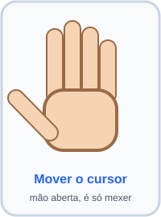

Basta **mexer a mão**. O cursor acompanha o movimento, de forma suave. A posição usada é o centro da sua mão.

### Cliques

Os cliques são feitos com **pinças**: encoste a ponta do polegar na ponta de outro dedo.

| Clique esquerdo | Clique direito | Clique duplo |
|:---:|:---:|:---:|
| 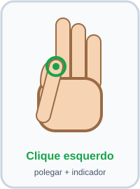 | 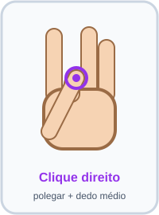 | 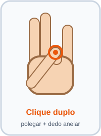 |
| **Polegar + indicador** | **Polegar + médio** | **Polegar + anelar** |
| Segure a pinça para **arrastar** (como segurar o botão do mouse) | Abre o menu de contexto | Dois cliques rápidos |

> 💡 O programa olha qual das pinças está mais fechada. Se nenhuma estiver fechada o bastante (veja `LIMITE_PINCA`), ele considera que você só está movendo o mouse.

### Continuar o movimento

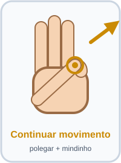

**Polegar + mindinho**: o cursor **continua andando sozinho** na direção em que você estava movendo a mão.

Serve para atravessar a tela sem precisar levar o braço até o limite da câmera.

- Para **parar**, solte a pinça.
- A mão não precisa continuar se mexendo.
- Os cliques são soltos enquanto esse gesto está ativo.

---

## ✋ Gestos da mão dos atalhos

Por padrão, é a **mão esquerda**.

### Rolagem contínua

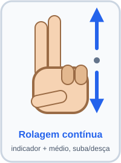

**Indicador + médio levantados** (como um "V").

Funciona como um **joystick**:

1. Faça o gesto. A posição da mão naquele momento vira o **ponto de partida**.
2. **Suba a mão** para rolar para cima, ou **desça** para rolar para baixo.
3. **Quanto mais longe** do ponto de partida, **mais rápido** rola.
4. Volte ao ponto de partida para **parar**.

Perto do ponto de partida existe uma **zona morta**, onde nada acontece. Ela evita que a página role sem querer por causa do tremor da mão.

### Zoom

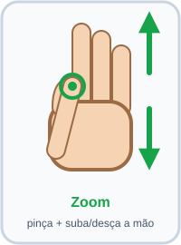

**Pinça polegar + indicador**, e depois **suba ou desça a mão**. O programa aperta `Ctrl` e rola, o que dá zoom na maioria dos programas.

Diferente da rolagem, o zoom **acompanha o arrasto** da mão: ele só muda enquanto você está movendo.

### Alternar janela (Alt + Tab)

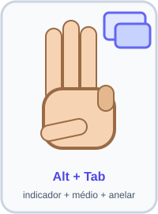

**Indicador + médio + anelar levantados.** Faz `Alt + Tab`, e só repete depois de 1 segundo.

### Voltar e avançar

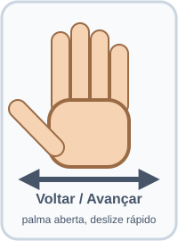

**Palma aberta** (com o polegar para fora), e **deslize a mão rápido** para o lado.

| Movimento | Atalho |
|---|---|
| Deslizar para a **direita** | `Alt + →` (avançar) |
| Deslizar para a **esquerda** | `Alt + ←` (voltar) |

Funciona em navegadores e em vários programas. Precisa ser um movimento **rápido**. Devagar não conta.

### Mostrar ou esconder a câmera

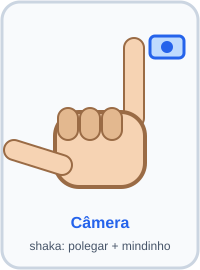

**Shaka**: polegar e mindinho para fora, os outros dedos fechados. Cada vez que você faz, a janela da câmera aparece ou some.

> ⚠️ Com a câmera escondida, a tecla `q` não funciona (não há janela em foco). Mostre a câmera de novo ou use `Ctrl+C` no terminal.

### Pausar e retomar

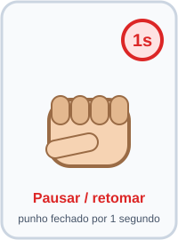

**Punho fechado por 1 segundo.** Na tela aparece uma contagem regressiva. Quando chega a zero, o controle **pausa**. Para **retomar**, faça o mesmo gesto de novo.

Com o controle pausado:

| O que | Estado |
|---|---|
| Cursor | ⏸️ parado |
| Rolagem, zoom, Alt+Tab e voltar/avançar | ⏸️ parados |
| Gesto das duas mãos | ⏸️ parado |
| **Punho** (para retomar) | ✅ continua funcionando |
| **Shaka** (câmera) | ✅ continua funcionando |

---

## 🙌 Gestos com as duas mãos

Mostre **as duas palmas abertas** (com os cinco dedos esticados) para a câmera.

| Maximizar a janela | Minimizar a janela |
|:---:|:---:|
| 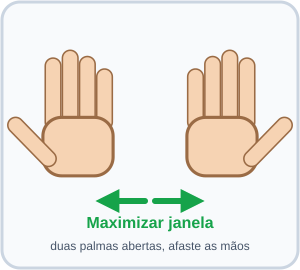 | 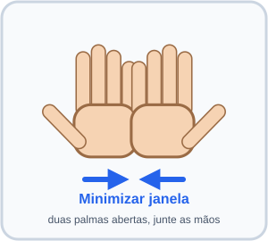 |
| **Afaste** as mãos uma da outra | **Junte** as mãos |

Isso age sobre a **janela que está em foco**.

- Mantenha as duas palmas abertas enquanto afasta ou junta.
- O gesto só dispara **uma vez a cada 1,5 segundo**.
- Enquanto ele está ativo, o cursor e os atalhos ficam **parados**, para você não clicar sem querer.
- No Windows, o programa maximiza ou minimiza a janela diretamente. Em outros sistemas, usa `Win + ↑` e `Win + ↓`.
- A janela da câmera do próprio programa **nunca** é minimizada por esse gesto.

---

## 🧾 Cola rápida: todos os gestos em uma tabela

### Mão do cursor (direita)

| Gesto | O que faz |
|---|---|
| Mover a mão | Move o cursor |
| Polegar + indicador | Clique esquerdo (segure para arrastar) |
| Polegar + médio | Clique direito |
| Polegar + anelar | Clique duplo |
| Polegar + mindinho | Cursor continua andando na direção atual |

### Mão dos atalhos (esquerda)

| Gesto | O que faz |
|---|---|
| Indicador + médio levantados, subir/descer a mão | Rolagem contínua |
| Pinça polegar + indicador, subir/descer a mão | Zoom (`Ctrl` + rolagem) |
| Indicador + médio + anelar levantados | `Alt + Tab` |
| Palma aberta, deslizar rápido para o lado | `Alt + →` / `Alt + ←` |
| Shaka (polegar + mindinho) | Mostrar ou esconder a câmera |
| Punho fechado por 1 segundo | Pausar ou retomar |

### Duas mãos

| Gesto | O que faz |
|---|---|
| Duas palmas abertas, afastar | Maximizar a janela |
| Duas palmas abertas, juntar | Minimizar a janela |

---

## ⚙️ Configurações

Todas ficam em `configuracoes.py`. Números maiores ou menores mudam o comportamento como descrito abaixo.

### Câmera e detecção

| Configuração | O que faz |
|---|---|
| `INDICE_CAMERA` | Qual câmera usar (`0` é a padrão) |
| `MAXIMO_DE_MAOS` | Quantas mãos detectar (use `2`) |
| `CONFIANCA_DETECCAO` | Confiança mínima do MediaPipe para aceitar uma mão (de 0 a 1) |
| `MAO_DO_CURSOR` | Qual mão move o cursor (`"Right"` ou `"Left"`). A outra vira a mão dos atalhos |

### Cursor

| Configuração | O que faz |
|---|---|
| `SENSIBILIDADE` | Velocidade do cursor (maior = mais rápido) |
| `SUAVIZACAO` | Suavidade do movimento (menor = mais suave, porém mais lento para responder) |
| `LIMITE_PINCA` | Quão fechada a pinça precisa estar para contar como clique |
| `VELOCIDADE_CONTINUA` | Quantos pixels por quadro o cursor anda no gesto "continuar movimento" |
| `DIRECAO_MINIMA` | Movimento mínimo para o programa guardar uma direção |

### Rolagem, zoom e atalhos

| Configuração | O que faz |
|---|---|
| `ZONA_MORTA_ROLAGEM` | Distância do ponto de partida em que a rolagem ainda não começa |
| `VELOCIDADE_ROLAGEM_CONTINUA` | Quão rápido rola ao afastar a mão do ponto de partida |
| `MAXIMO_ROLAGEM` | Limite de rolagem por quadro |
| `VELOCIDADE_ZOOM` | Velocidade do zoom |
| `MOVIMENTO_MINIMO` | Ignora tremidinhas pequenas no zoom |
| `VELOCIDADE_DESLIZE` | Velocidade que o gesto de voltar/avançar precisa ter |
| `TEMPO_PARA_PAUSAR` | Segundos com o punho fechado para pausar |
| `TEMPO_ENTRE_ATALHOS` | Intervalo mínimo entre atalhos repetidos |

### Duas mãos

| Configuração | O que faz |
|---|---|
| `VARIACAO_DUAS_MAOS` | O quanto as mãos precisam se afastar ou aproximar para disparar |
| `TEMPO_ENTRE_DUAS_MAOS` | Intervalo mínimo entre dois acionamentos |

### Janela da câmera

| Configuração | O que faz |
|---|---|
| `NOME_JANELA` | Título da janela |
| `LARGURA_JANELA` / `ALTURA_JANELA` | Tamanho da janela |
| `TECLA_PARA_SAIR` | Tecla que fecha o programa (padrão `q`) |

---

## 🗂️ Estrutura do projeto

| Arquivo | Responsabilidade |
|---|---|
| `principal.py` | Laço principal que junta tudo |
| `configuracoes.py` | Constantes e ajustes |
| `detector.py` | Detecção das mãos com MediaPipe e cálculos de pinça e dedos |
| `cursor.py` | Movimento do cursor, cliques e "continuar movimento" |
| `atalhos.py` | Rolagem, zoom, atalhos, pausa e câmera |
| `duasmaos.py` | Gesto das duas mãos (maximizar e minimizar) |
| `janela.py` | Janela da câmera e tecla de saída |

### Como as peças conversam

```
principal.py
 ├─ detector.py   → acha as mãos e diz quais dedos estão levantados
 ├─ duasmaos.py   → as duas palmas estão abertas? afastando ou juntando?
 ├─ cursor.py     → mão do cursor: move, clica, continua
 ├─ atalhos.py    → mão dos atalhos: rola, zoom, Alt+Tab, pausa...
 └─ janela.py     → desenha o vídeo e os textos na tela
```

Ordem de prioridade a cada quadro:

1. Se as **duas palmas** estão abertas, só o gesto das duas mãos vale.
2. Senão, a **mão do cursor** e a **mão dos atalhos** trabalham ao mesmo tempo.

---

## 🩺 Problemas comuns

| Problema | O que fazer |
|---|---|
| O cursor é controlado pela mão errada | Troque `MAO_DO_CURSOR` para `"Left"` ou `"Right"` |
| Os cliques disparam sem querer | **Diminua** `LIMITE_PINCA` |
| Os cliques não disparam | **Aumente** `LIMITE_PINCA` |
| O cursor treme | Diminua `SUAVIZACAO` ou `SENSIBILIDADE` |
| A página rola sozinha | Aumente `ZONA_MORTA_ROLAGEM` |
| A rolagem é rápida ou lenta demais | Ajuste `VELOCIDADE_ROLAGEM_CONTINUA` e `MAXIMO_ROLAGEM` |
| Voltar/avançar dispara sem querer | Aumente `VELOCIDADE_DESLIZE` |
| Voltar/avançar não dispara | Diminua `VELOCIDADE_DESLIZE` |
| Maximizar/minimizar dispara sem querer | Aumente `VARIACAO_DUAS_MAOS` |
| As mãos não são detectadas | Melhore a luz e deixe o fundo mais limpo, ou diminua `CONFIANCA_DETECCAO` |
| A câmera não abre | Troque `INDICE_CAMERA` (`1`, `2`...) e feche outros programas que usam a câmera |

### Dicas para funcionar melhor

- Use **boa iluminação** e um fundo sem muita bagunça.
- Deixe as **duas mãos visíveis** e evite que se sobreponham.
- Mantenha os dedos bem **separados** nos gestos de dedos levantados.
- Faça os gestos de frente para a câmera, com a palma voltada para ela.

---

## ⚠️ Limitações

- Manter a janela da câmera **sempre por cima** funciona no Windows. Em outros sistemas pode não ter efeito.
- Maximizar e minimizar com as duas mãos usa a API do Windows. Em outros sistemas usa os atalhos `Win + ↑` e `Win + ↓`.
- O atalho de voltar/avançar usa `Alt + seta`, comum em navegadores.
- Com a câmera escondida, a tecla `q` não funciona. Mostre a câmera de novo ou use `Ctrl+C`.
- O PyAutoGUI tem uma **proteção**: levar o mouse a um canto da tela interrompe o programa. O gesto "continuar movimento" já evita os cantos.

---

## 🤝 Contribuindo e licença

Contribuições são bem-vindas! Você pode:

- abrir **issues** com bugs e ideias;
- enviar melhorias de código;
- criar **novos gestos**;
- melhorar a documentação.

Este é um projeto **open source**. O código é livre para uso, estudo, modificação e distribuição.
